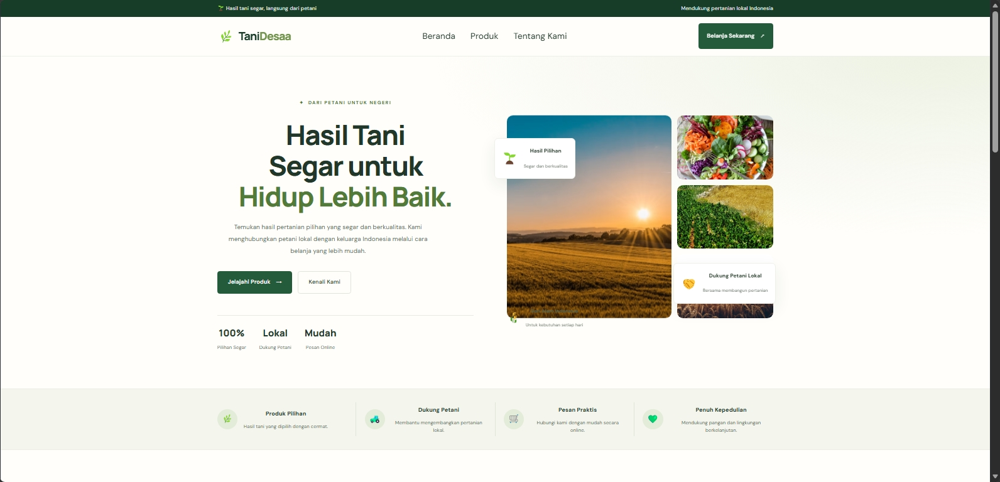
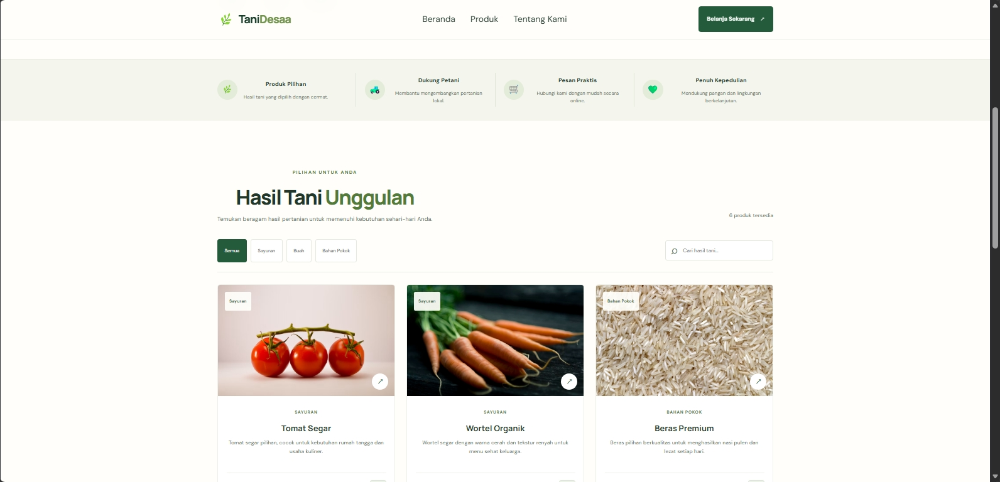
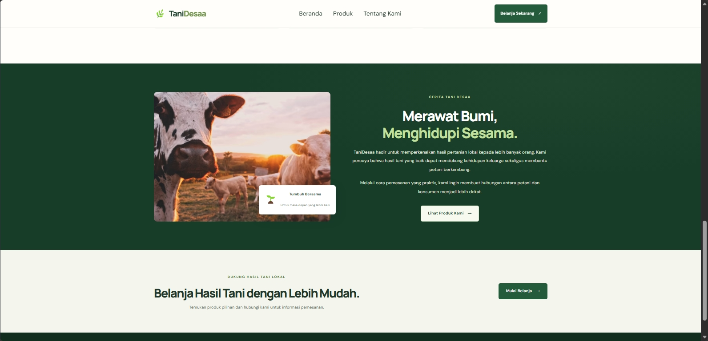

# 🌿 TaniDesaa — Local Agriculture Website

TaniDesaa is a responsive agriculture website concept designed to showcase local farming products and support the connection between farmers and their communities.

Inspired by rural agriculture in Indonesia, this project combines a clean user interface, product discovery features, and convenient contact options in one accessible website.

This project was developed as part of my Front-End Web Development portfolio.

## 🖼️ Preview

### Main Website


### Website Screenshots

| Preview 1 | Preview 2 |
|---|---|
|  |  |

### Additional Preview



## ✨ Features

- **Responsive Design** — Designed to adapt to desktop and mobile screens.
- **Agricultural Product Catalog** — Browse products related to local farming.
- **Product Search** — Find products by name.
- **Category Filtering** — Filter products by category.
- **Product Details** — View additional information about selected products.
- **WhatsApp Contact** — Convenient communication for product inquiries.
- **Agriculture-Inspired Design** — A green and cream visual theme inspired by farming and rural landscapes.

## 🛠️ Technologies

- React.js
- JavaScript
- HTML5
- CSS3
- Vite
- Git and GitHub

## 🚀 Getting Started

Follow these steps to run the project locally.

### 1. Clone the repository

```bash
git clone https://github.com/ujngflsh/tanidesaa.git
```

### 2. Navigate to the project folder

```bash
cd tanidesaa
```

### 3. Install dependencies

```bash
npm install
```

### 4. Start the development server

```bash
npm run dev
```

Open the local URL displayed in your terminal.

## 📁 Project Structure

```text
tanidesaa/
├── public/
│   ├── Preview.png
│   ├── Preview-1.png
│   ├── Preview-2.png
│   └── Preview-3.png
├── src/
│   ├── assets/
│   ├── App.jsx
│   ├── App.css
│   ├── index.css
│   └── main.jsx
├── index.html
├── package.json
└── vite.config.js
```

## 🎯 Project Goals

- Practice building responsive user interfaces with React.
- Demonstrate product search, category filtering, and interactive UI development.
- Explore website design opportunities for local agriculture and rural communities.
- Build a practical project for my Front-End Web Development portfolio.

## 👨‍💻 Developer

**Ujang — Front-End Web Developer**

- GitHub: [@ujngflsh](https://github.com/ujngflsh)
- Project Repository: [TaniDesaa](https://github.com/ujngflsh/tanidesaa)

---

*Built as a portfolio project inspired by local agriculture and rural communities in Indonesia.*
